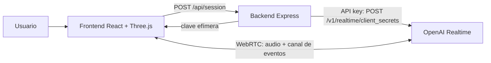

# Mascota 3D conversacional de ENDE Oruro

Asistente web con un personaje 3D (un quirquincho con casco y overol de ENDE) que conversa por voz o por texto en tiempo real usando la API Realtime de OpenAI.

- Repositorio: https://github.com/JulioCesarAnturiano/endeOruro
- Estado: prototipo funcional (octubre de 2026)

## 1. Objetivo y alcance

La empresa pidió un chatbot que responda en tiempo real a través de un personaje 3D, por voz o por texto. El prototipo cubre:

- Conversación de voz a voz y por texto en español, con transcripción en pantalla.
- Personaje 3D animado según el estado de la conversación, con la boca sincronizada al volumen de la voz.
- Escenario de una subestación eléctrica nocturna y entrada del personaje con un rayo.

Todavía no tiene conocimiento real de la empresa: ese contenido llegará de una API externa que proveerá ENDE (ver sección 9).

## 2. Arquitectura

La API key de OpenAI vive solo en el backend. El navegador pide al backend una clave efímera de un solo uso y con ella abre una conexión WebRTC directa con OpenAI, por donde viajan el audio y los eventos.



1. El usuario pulsa **Iniciar conversación**.
2. El frontend llama a `POST /api/session` con el nombre recordado, si lo hay. El backend crea la sesión en OpenAI (modelo, voz, instrucciones, herramientas y transcripción) y devuelve la clave efímera.
3. El frontend crea un `RTCPeerConnection` con un transceptor de audio y un canal de datos `oai-events`, y envía su oferta SDP a `https://api.openai.com/v1/realtime/calls?model=...`.
4. El audio de respuesta llega como stream remoto: se reproduce y pasa por un `AnalyserNode` que mueve la mandíbula.
5. La mascota no habla al conectar: espera el primer mensaje de la persona.
6. El texto se envía por el canal de datos con `conversation.item.create` seguido de `response.create`.

## 3. Tecnologías

| Capa | Tecnología | Uso |
|---|---|---|
| Frontend | React 19, TypeScript, Vite 8 | Interfaz y empaquetado |
| 3D | Three.js 0.186, React Three Fiber 9, drei 10 | Carga del GLB, animaciones, efectos |
| Backend | Node 24, Express 5 | Claves efímeras y servido del build |
| IA | OpenAI Realtime (`gpt-realtime`) | Conversación de voz a voz |
| Transcripción | `gpt-4o-mini-transcribe`, idioma `es` | Texto de lo que dice el usuario |
| Modelado | Tripo Studio, Blender 5.2 | Generación, retopología, rig y animaciones |

## 4. Estructura del repositorio

```
endeOruro/
├─ CLAUDE.md                 contexto para Claude Code
├─ docs/PROYECTO.md          este documento
├─ package.json              workspaces + "npm run dev" para ambos
├─ Dockerfile, .dockerignore imagen de producción (ver sección 7)
├─ docker-compose.yml        app + Caddy (HTTPS automático)
├─ Caddyfile, .env.example   dominio público del despliegue
├─ assets-src/
│  └─ mascota_ende.blend     fuente editable: malla, rig, animaciones, texturas empaquetadas
├─ backend/
│  ├─ .env.example           plantilla de configuración (el .env real no se sube)
│  ├─ package.json
│  └─ src/
│     ├─ index.js            POST /api/session y servido de frontend/dist
│     └─ instructions.js     personalidad, conocimiento y herramienta guardar_nombre
└─ frontend/
   ├─ index.html, vite.config.ts, tsconfig.json, package.json
   ├─ public/
   │  ├─ models/mascota_ende.glb
   │  └─ backgrounds/subestacion.svg
   └─ src/
      ├─ App.tsx                  escenario, fondo, fogonazo y panel de chat
      ├─ avatar/Scene.tsx         cámara, luces, entrada del personaje, sacudida
      ├─ avatar/Mascot.tsx        clips por estado y movimiento de la mandíbula
      ├─ effects/intro.ts         tiempos y estado de la entrada
      ├─ effects/Lightning.tsx    rayo, chispas, anillo y marca en el suelo
      ├─ effects/thunder.ts       trueno sintetizado con Web Audio
      ├─ realtime/useRealtime.ts  WebRTC, micrófono, eventos y mensajes
      └─ components/ChatPanel.tsx
```

## 5. Modelo 3D

### Generación en Tripo Studio

El personaje se generó desde una imagen de referencia con el modelo HD. La primera versión tenía unos 1,9 millones de triángulos, demasiado para web, y se regeneró con:

| Parámetro | Valor |
|---|---|
| Ultra Mesh Quality | Activado |
| AI Complete | Apagado |
| Texture / PBR | Activados, 2K |
| Remove Lighting | Activado |
| Topology / Polycount | Quad, 25 000 (resultado: 24 425 caras) |
| Exportación | FBX con preset Blender, texturas 2K |

### Rig y pesos en Blender

- Esqueleto de 28 huesos: `Hips`, `Spine`, `Chest`, `Neck`, `Head`, `Jaw`, `Ear.L/R`, `Shoulder`, `UpperArm`, `LowerArm`, `Hand`, `UpperLeg`, `LowerLeg`, `Foot`, `Toe` (lados `.L` y `.R`) y `Tail1` a `Tail4`. Eje de frente del personaje: -Y en Blender; altura total 0,98 m con los pies en Z = 0.
- Pesos automáticos (bone heat) con dos correcciones: el caparazón y la espalda quedan rígidos al torso (solo `Hips`, `Spine`, `Chest` y la cola influyen ahí), y cada vértice tiene como máximo 4 huesos, el límite de glTF.
- Se eliminaron 172 vértices sueltos que dejó el generador.
- Se trabajó con scripts de Python en Blender sin interfaz, verificando con renders de poses de prueba.

### Animaciones en el GLB

| Clip | Duración | Uso en la app |
|---|---|---|
| `Idle` | 4,0 s | Reposo y escucha: respiración, cola y orejas |
| `Talk` | 3,0 s | Mientras habla: gestos de brazos y cabeza |
| `Think` | 3,0 s | Mientras espera la respuesta: cabeza ladeada |
| `JawLoop` | 2,0 s | Solo mandíbula; respaldo para pruebas |
| `Wave` | 3,0 s | Saludo; sigue en el archivo pero no se usa |

Los clips de cuerpo no animan la mandíbula, así que el código la mueve mientras corre `Talk`. Archivo final: `mascota_ende.glb`, 3,2 MB, 48 597 triángulos, texturas JPEG (color, normal y metal/rugosidad combinados).

Ajustes de exportación glTF usados en Blender (para reexportar igual):

- Formato GLB, Y arriba, skins y animaciones activados, sin morphs.
- `export_animation_mode='NLA_TRACKS'`: cada pista NLA del armature es un clip; todas las pistas deben estar sin silenciar al exportar.
- `export_optimize_animation_keep_anim_armature=False`: cada clip solo lleva los huesos que anima (sin esto la mandíbula quedaría fijada en todos los clips).
- `export_image_format='JPEG'`, calidad 90.
- Las acciones empiezan en el cuadro 0 y el último cuadro repite el primero, para que el bucle no salte.

En el `.blend` solo la pista `Idle` queda activa, para que al abrirlo no se mezclen los clips.

### Boca

El modelo salió de Tripo con la boca abierta en una sonrisa, con dientes y lengua: esa es la pose de reposo. Al hablar, el hueso `Jaw` rota sobre su eje local `(-1, 0, 0)` entre -15° (casi cerrada) y +4°, según el volumen RMS del audio de respuesta, con suavizado (abre rápido, cierra más lento). Al dejar de hablar vuelve suavemente a la sonrisa. Constantes en `frontend/src/avatar/Mascot.tsx`.

## 6. Comportamiento en pantalla

| Estado | Cuándo | Clip |
|---|---|---|
| `idle` | Sin conversación; el personaje no está en escena | — |
| `connecting` | Tras pulsar Iniciar; se dispara la entrada con el rayo | `Idle` |
| `listening` | Canal abierto, esperando al usuario | `Idle` |
| `thinking` | El usuario terminó de hablar o envió texto | `Think` |
| `speaking` | Entre `output_audio_buffer.started` y `stopped` | `Talk` + mandíbula |

### Entrada con rayo

Tiempos en `frontend/src/effects/intro.ts`, en segundos desde que se pulsa Iniciar:

1. 0,13 s: destello previo.
2. 0,25 s (`STRIKE`): cae un rayo ramificado (desplazamiento de punto medio) con fogonazo en pantalla, luz de impacto, sacudida de cámara y trueno.
3. El personaje aparece 0,45 m sobre el suelo y cae en 0,22 s (`DROP`), con un rebote de aplastamiento al aterrizar.
4. En el suelo: 90 chispas con gravedad, un anillo de energía que se expande y una marca chamuscada que se borra en 4 s.
5. Al terminar la conversación el personaje se encoge en 0,35 s (`LEAVE`); la siguiente conversación repite la entrada.

El fogonazo es una animación CSS (`.stage__flash` en `styles.css`) cuyos porcentajes están calculados para `STRIKE = 0.25`; si se cambia `STRIKE` hay que ajustar esos porcentajes. El trueno se sintetiza con Web Audio (ruido blanco filtrado para el chasquido y ruido marrón para el retumbo), sin archivos de audio.

### Fondo

`frontend/public/backgrounds/subestacion.svg` es una ilustración vectorial de 1920×1080 hecha para el proyecto: pórticos de celosía, transformadores con bushings, seccionadores, conductores, cerca con letrero de alta tensión y reflectores. Tiene animaciones CSS ligeras: balizas rojas, energía que recorre los conductores, nubes que se desplazan y relámpagos lejanos. Se muestra como `` con `object-fit: cover` anclado abajo, detrás de un canvas transparente. Se reemplaza cambiando `BACKGROUND_URL` en `frontend/src/App.tsx`.

### Micrófono

La conexión se abre con un transceptor de audio `sendrecv` sin pista. El permiso se pide recién al pulsar **Activar micrófono** y la pista se engancha con `replaceTrack`, sin renegociar. Si falla, el panel muestra el motivo (permiso denegado, sin dispositivo o navegador no compatible).

### Nombre de la persona

La mascota no habla al conectar: espera a que la persona diga algo; en su primera respuesta la saluda, se presenta como la mascota de ENDE Oruro y le pregunta solo cómo se llama. Si no lo quiere decir, no insiste. Cuando la persona lo dice, el modelo llama a la herramienta `guardar_nombre`. El frontend lo guarda en `localStorage` (clave `ende.nombre`), lo muestra en la cabecera del chat, devuelve el `function_call_output` y pide una nueva respuesta para que la mascota la salude por su nombre. Las llamadas se procesan en `response.done`, porque no se puede crear otra respuesta mientras una sigue activa.

En la siguiente conversación el frontend envía el nombre a `POST /api/session` y el backend lo agrega a las instrucciones, antes limpiándolo (solo letras, espacios, apóstrofos y guiones, máximo 40 caracteres). Como el mismo equipo lo usa mucha gente, la mascota no da el nombre por hecho: tras su primera respuesta pregunta "¿Eres Ana?" y, si no es, pide el nombre nuevo. Los textos están en `backend/src/instructions.js`.

### Orden de los mensajes

La transcripción de voz del usuario llega después de que empieza la respuesta. Al crearse el ítem del usuario (`conversation.item.added` / `created`) se reserva su lugar usando `previous_item_id`, y los ítems sin texto todavía no se muestran.

## 7. Configuración y ejecución

Variables en `backend/.env` (no se sube al repositorio; copiar desde `backend/.env.example`):

```
OPENAI_API_KEY=sk-...
OPENAI_REALTIME_MODEL=gpt-realtime
OPENAI_VOICE=coral        # otras: cedar, marin, alloy, ash, ballad, echo, sage, verse, shimmer
PORT=3001
```

```bash
npm install        # desde la raíz; instala frontend y backend
npm run dev        # backend en :3001 y frontend en http://localhost:5173
npm run build      # compila el frontend a frontend/dist
npm start          # el backend sirve la API y el frontend compilado
```

Vite redirige `/api` al backend en desarrollo. El micrófono requiere Chrome o Safari: el navegador integrado de VS Code no lo permite.

### Despliegue con Docker

El navegador solo da acceso al micrófono con HTTPS (o en `localhost`), así que la app necesita un dominio con certificado. Para el festival se usa un subdominio gratis de **DuckDNS**; cuando ENDE dé su dominio oficial basta con cambiar `DOMAIN`.

- `Dockerfile`: dos etapas. Compila el frontend y deja una imagen con solo el backend, Express y `frontend/dist`. Las variables llegan desde `docker-compose.yml`; no hay `.env` dentro de la imagen.
- `docker-compose.yml`: el servicio `app` (puerto 3001, solo interno) y `caddy` (puertos 80 y 443), que pide y renueva el certificado de Let's Encrypt. Los certificados se guardan en el volumen `caddy_data`.

Pasos en el servidor Linux:

1. Entrar a https://www.duckdns.org con una cuenta de Google o GitHub, crear el subdominio (p. ej. `endeoruro`) y poner la IP pública del servidor.
2. Abrir los puertos 80 y 443 en el firewall del servidor y del proveedor (Let's Encrypt valida por el 80).
3. Instalar Docker con el plugin compose y clonar el repositorio.
4. Crear `backend/.env` con la API key (copiar desde `backend/.env.example`) y `.env` en la raíz con `DOMAIN=endeoruro.duckdns.org` (copiar desde `.env.example`).
5. `docker compose up -d --build`. La primera vez Caddy tarda unos segundos en obtener el certificado; `docker compose logs -f caddy` lo muestra.

Para actualizar: `git pull && docker compose up -d --build`. Para cambiar la clave o la voz: editar `backend/.env` y `docker compose up -d`.

## 8. Decisiones tomadas

- **WebRTC directo con OpenAI** en lugar de encadenar transcripción, chat y síntesis de voz: menor latencia y cortes naturales cuando el usuario interrumpe.
- **Backend mínimo**: existe solo para proteger la API key. Se descartó una carpeta de base de datos porque los datos llegarán por una API externa.
- **Sin saludo**: el clip `Wave` se quitó a pedido del cliente y se reemplazó por la entrada con rayo.
- **Docker + Caddy + DuckDNS para desplegar**: misma versión de Node en cualquier servidor, HTTPS automático y un dominio gratis y legible para el festival. Se prefirió DuckDNS sobre sslip.io porque el nombre es fácil de escribir o poner en un QR y su límite de certificados es por subdominio, no compartido.
- **Fondo y trueno generados por código** para no depender de material externo mientras no haya fotos oficiales.

## 9. Pendientes y limitaciones

### Pendiente

- **Contenido del bot**: completar `backend/src/instructions.js` con servicios, horarios y preguntas frecuentes.
- **API de ENDE**: cuando esté disponible, exponerla al modelo como herramienta (function calling): el modelo pide el dato, el sistema consulta la API y el modelo responde con el resultado.
- **Material gráfico**: foto o ilustración real de una subestación de ENDE en Oruro (horizontal, mínimo 1920×1080) y, opcionalmente, un sonido de trueno libre de derechos.
- **Despliegue**: listo con Docker y DuckDNS (sección 7). Falta elegir el servidor y, a futuro, pasar al dominio oficial de ENDE.
- **Licencia**: confirmar que el plan de Tripo usado permite uso comercial del modelo, ya que lleva la marca ENDE.

### Limitaciones conocidas

- La boca no cierra por completo: el modelo base sonríe con la boca abierta.
- Sin parpadeo ni movimiento de ojos: están pintados en la textura.
- Sin huesos en los dedos; las manos se mueven como una pieza.
- Con el brazo levantado al máximo, la tela de la axila se estira un poco vista desde atrás.
- Las animaciones se hicieron por código y son básicas; un animador puede mejorarlas sobre el mismo esqueleto en `assets-src/mascota_ende.blend`.
